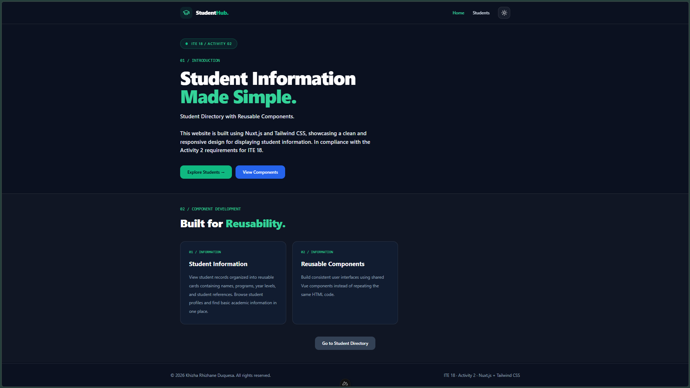
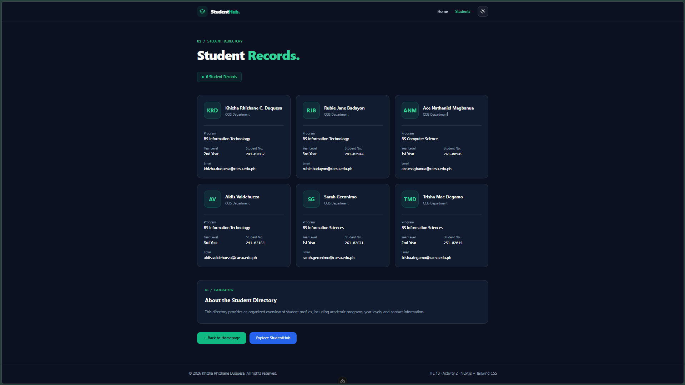

# StudentHub – Student Information Website

**ITE 18 – Activity 2: Reusable Components and Props**

StudentHub is a responsive student information website developed using Nuxt.js, Vue 3, TypeScript, and Tailwind CSS.

The application demonstrates component-based development through reusable Vue components, shared layouts, and props.

## Features

- Student directory displaying six student profiles
- Reusable student cards with dynamic data through props
- Shared navigation header and footer
- Reusable information cards
- Customizable buttons with different labels and colors
- Dark and light mode
- Responsive layout for desktop and mobile devices

## Reusable Components

| Component | Description |
|---|---|
| `AppHeader.vue` | Shared website navigation |
| `AppFooter.vue` | Shared website footer |
| `StudentCard.vue` | Displays student information using props |
| `InfoCard.vue` | Displays a title and description |
| `AppButton.vue` | Reusable button with configurable label, color, and navigation |

## Technologies Used

- Nuxt.js
- Vue.js 3
- TypeScript
- Tailwind CSS
- Lucide Icons

## Project Structure

```text
app/
├── components/
│   ├── AppButton.vue
│   ├── AppFooter.vue
│   ├── AppHeader.vue
│   ├── InfoCard.vue
│   └── StudentCard.vue
├── layouts/
│   └── default.vue
├── pages/
│   ├── index.vue
│   └── students.vue
└── app.vue
```

## Application Screenshots

### Homepage



### Student Directory



### Project Folder Structure


## Installation and Setup

Install dependencies:

```bash
npm install
```

Start the development server:

```bash
npm run dev
```

Open http://localhost:3000 in your browser.

To verify the production build:

```bash
npm run build
```

## Developer

**Khizha Rhizhane C. Duquesa**

Bachelor of Science in Information Technology
Caraga State University – Main Campus
